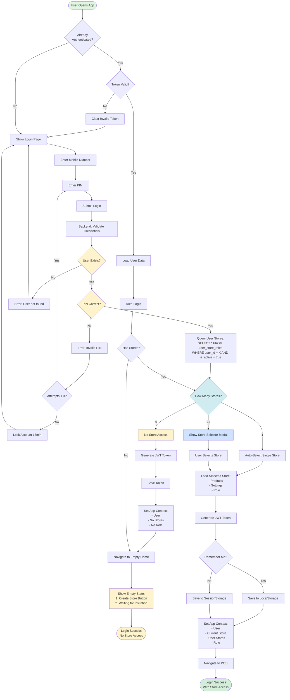
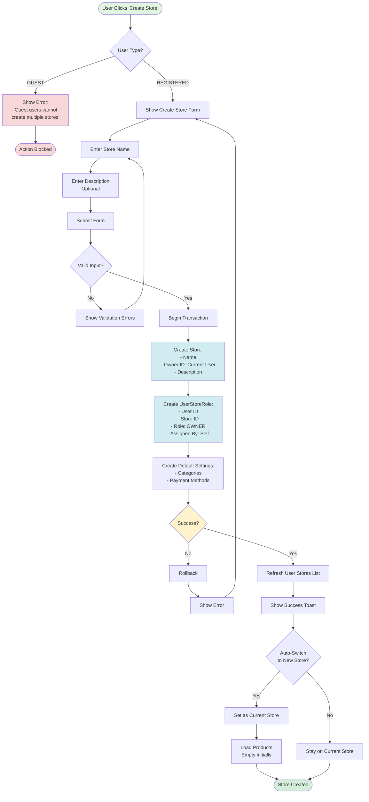
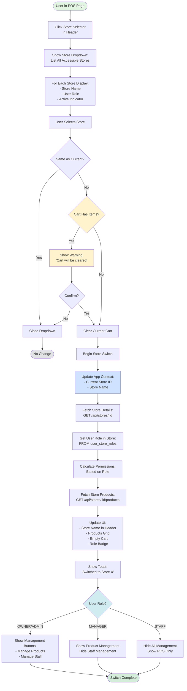
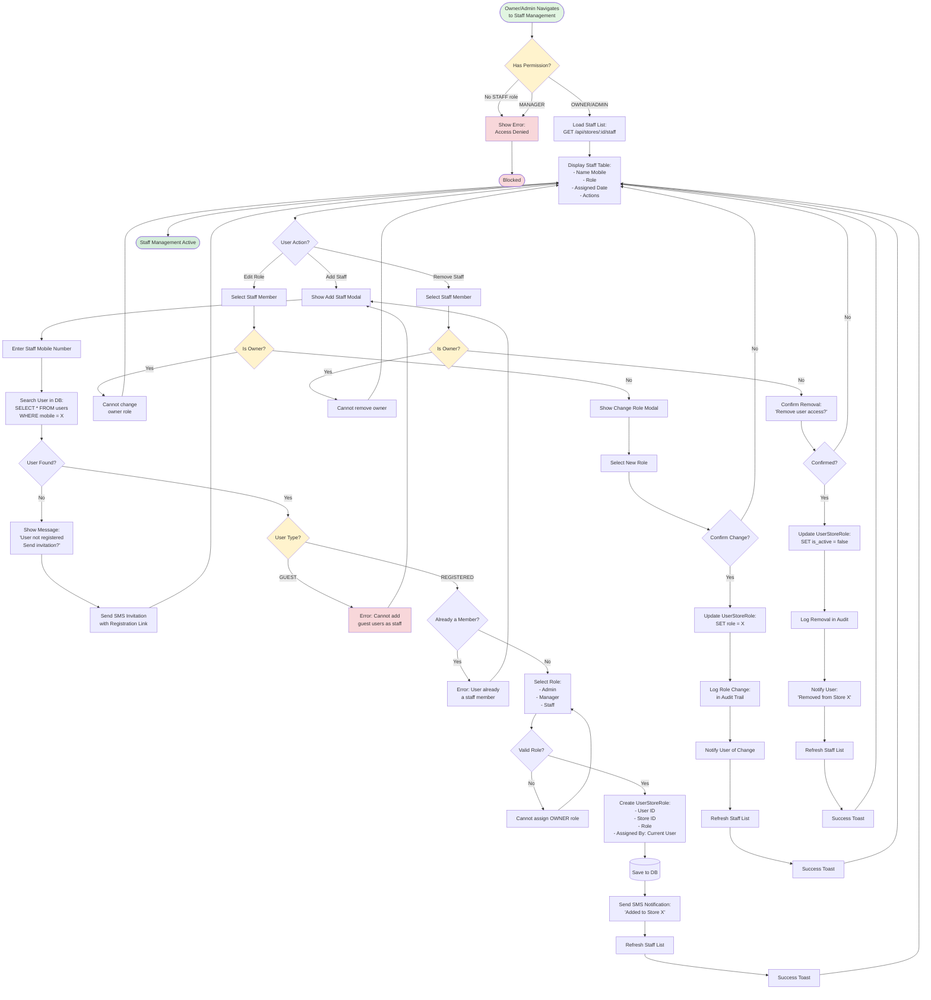
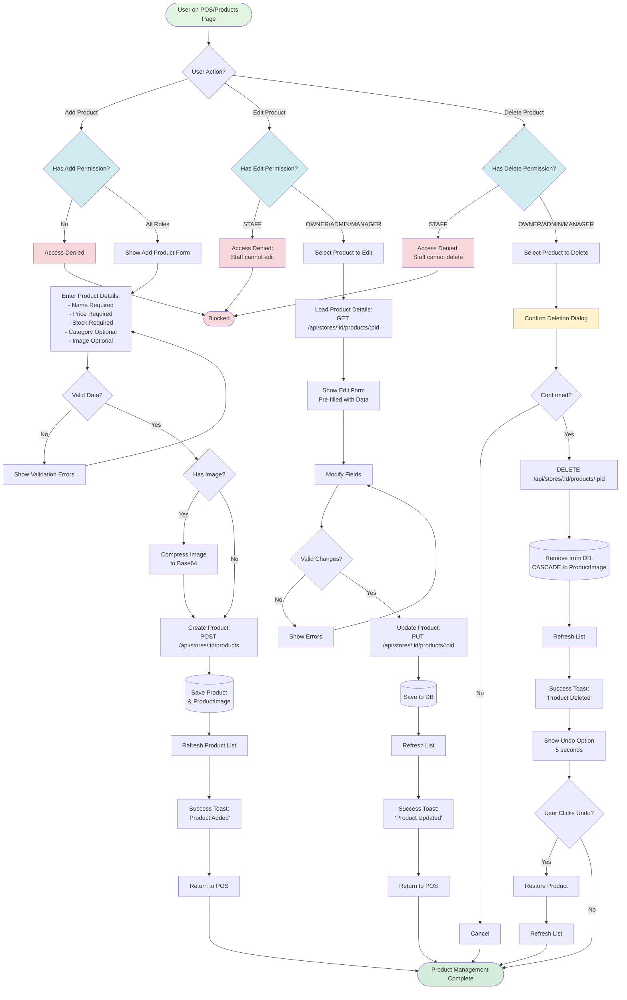
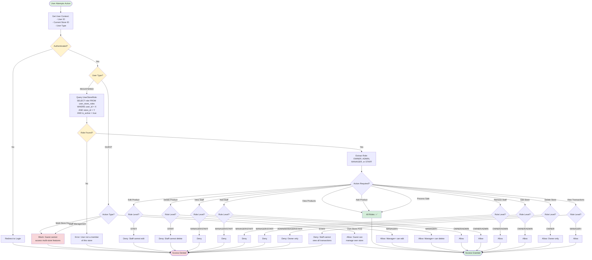
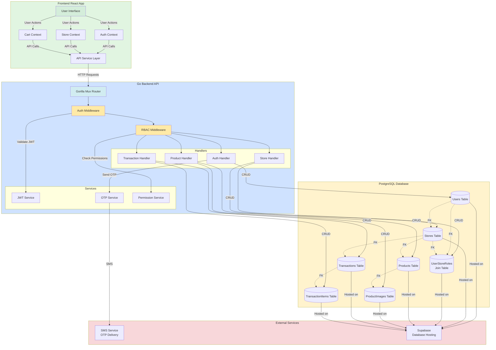

# Multi-Store POS System - Process Flowcharts

This document contains detailed flowcharts for all major processes in the Multi-Store POS System.

**Last Updated:** November 10, 2025

---

## Table of Contents
1. [User Registration Flow](#1-user-registration-flow)
2. [Guest Login Flow](#2-guest-login-flow)
3. [User Login Flow](#3-user-login-flow)
4. [Store Creation Flow](#4-store-creation-flow)
5. [Store Switching Flow](#5-store-switching-flow)
6. [Staff Management Flow](#6-staff-management-flow)
7. [Product Management Flow](#7-product-management-flow)
8. [POS Transaction Flow](#8-pos-transaction-flow)
9. [Role-Based Access Control Flow](#9-role-based-access-control-flow)
10. [Complete System Architecture](#10-complete-system-architecture)

---

## 1. User Registration Flow

### Registered User Registration (Store Creation Optional)

```mermaid
graph TD
    Start([User Opens App]) --> Landing[Landing Page]
    Landing --> RegChoice{Choose Login Type}
    
    RegChoice -->|Register| RegStart[Click 'Register']
    RegChoice -->|Login| LoginFlow[Go to Login Flow]
    RegChoice -->|Guest| GuestFlow[Go to Guest Flow]
    
    RegStart --> EnterMobile[Enter Mobile Number]
    EnterMobile --> ValidateMobile{Valid Mobile?}
    ValidateMobile -->|No| ErrorMobile[Show Error]
    ErrorMobile --> EnterMobile
    
    ValidateMobile -->|Yes| SendOTP[Backend: Send OTP]
    SendOTP --> SaveOTP[(Save OTP in DB<br/>Expires in 5 min)]
    SaveOTP --> ShowOTPInput[Show OTP Input Screen]
    
    ShowOTPInput --> EnterOTP[User Enters OTP]
    EnterOTP --> VerifyOTP{OTP Correct?}
    VerifyOTP -->|No| WrongOTP[Show Error]
    WrongOTP --> RetryOTP{Retry Count < 3?}
    RetryOTP -->|Yes| EnterOTP
    RetryOTP -->|No| ResendOTP[Resend OTP Option]
    ResendOTP --> SendOTP
    
    VerifyOTP -->|Yes| MarkVerified[Mark OTP as Verified]
    MarkVerified --> EnterPIN[Enter 6-Digit PIN]
    EnterPIN --> ConfirmPIN[Confirm PIN]
    ConfirmPIN --> PINMatch{PINs Match?}
    PINMatch -->|No| EnterPIN
    
    PINMatch -->|Yes| CreateUser[Create User Record:<br/>- ID: UUID<br/>- Mobile: xxx-xxx-xxxx<br/>- PIN Hash: bcrypt<br/>- Type: REGISTERED]
    
    CreateUser --> AskStore{Create Store Now?}
    
    AskStore -->|Skip for Now| GenToken1[Generate JWT Token]
    GenToken1 --> SaveToken1[Save Token]
    SaveToken1 --> SetContextNoStore[Set App Context:<br/>- User<br/>- No Stores<br/>- No Role]
    SetContextNoStore --> NavEmpty[Navigate to Empty Home]
    NavEmpty --> ShowEmptyState[Show Empty State:<br/>- Create Store option<br/>- Wait for invitation]
    ShowEmptyState --> End1([Registration Complete<br/>No Store Access])
    
    AskStore -->|Yes, Create Store| EnterStoreName[Enter Store Name]
    EnterStoreName --> ValidateStore{Store Name Valid?}
    ValidateStore -->|No| StoreError[Show Error:<br/>Min 3 characters]
    StoreError --> EnterStoreName
    
    ValidateStore -->|Yes| BeginTx[Begin Database Transaction]
    
    BeginTx --> CreateStore[Create Store Record:<br/>- ID: UUID<br/>- Name: Store Name<br/>- Owner ID: User ID<br/>- Active: true]
    
    CreateStore --> AssignOwner[Create UserStoreRole:<br/>- User ID<br/>- Store ID<br/>- Role: OWNER<br/>- Assigned At: now]
    
    AssignOwner --> CommitTx{Transaction Success?}
    CommitTx -->|No| Rollback[Rollback Store Creation]
    Rollback --> ShowError[Show Error Message]
    ShowError --> AskStore
    
    CommitTx -->|Yes| GenToken2[Generate JWT Token:<br/>- User ID<br/>- User Type<br/>- Exp: 24h]
    
    GenToken2 --> SaveToken2[Save Token:<br/>- LocalStorage or<br/>- SessionStorage]
    
    SaveToken2 --> SetContext[Set App Context:<br/>- User<br/>- Current Store<br/>- User Stores<br/>- Role: OWNER]
    
    SetContext --> NavPOS[Navigate to POS]
    NavPOS --> End2([Registration Complete<br/>With Store Access])
    
    style Start fill:#e1f5e1
    style End1 fill:#fff3cd
    style End2 fill:#d4edda
    style CommitTx fill:#fff3cd
    style CreateUser fill:#d1ecf1
    style CreateStore fill:#d1ecf1
    style AssignOwner fill:#d1ecf1
    style GenToken2 fill:#d4edda
    style NavPOS fill:#d4edda
    style ShowEmptyState fill:#fff3cd
    style AskStore fill:#cfe2ff
```



**Key Steps:**
1. User enters mobile number
2. System sends OTP via SMS
3. User verifies OTP (3 attempts max)
4. User creates 6-digit PIN and confirms
5. **System creates user account** (REGISTERED type)
6. **Optional Store Creation:**
   - **If user chooses "Skip":**
     - User logged in without store
     - Redirected to empty home page
     - Shows options: Create Store or Wait for Invitation
     - User has no role until joining/creating a store
   - **If user chooses "Create Store":**
     - User enters Store Name
     - System creates store record
     - UserStoreRole created (OWNER role)
     - User redirected to POS with full access
7. JWT token generated and stored in both paths
```

**Key Steps:**
1. User enters mobile number
2. System sends OTP via SMS
3. User verifies OTP (3 attempts max)
4. User creates 6-digit PIN
5. User enters Store Name (required)
6. System creates:
   - User account (REGISTERED type)
   - Store record (user as owner)
   - UserStoreRole (OWNER role)
7. JWT token generated and stored
8. User redirected to POS with full access

---

## 2. Guest Login Flow

### Guest User Login (No Registration Required)

```mermaid
graph TD
    Start([User Opens App]) --> Landing[Landing Page]
    Landing --> GuestClick[Click 'Continue as Guest']
    
    GuestClick --> Confirm{Confirm Guest Mode?}
    Confirm -->|Cancel| Landing
    
    Confirm -->|Yes| ShowWarning[Show Warning:<br/>- Data not saved<br/>- Session only<br/>- Limited features]
    
    ShowWarning --> Accept{User Accepts?}
    Accept -->|No| Landing
    
    Accept -->|Yes| EnterStoreName[Enter Store Name<br/>for Guest Store]
    
    EnterStoreName --> ValidateStore{Valid Name?}
    ValidateStore -->|No| ErrorName[Show Error]
    ErrorName --> EnterStoreName
    
    ValidateStore -->|Yes| BeginTx[Begin Transaction]
    
    BeginTx --> GenSession[Generate Session Token:<br/>Random UUID]
    
    GenSession --> CreateGuest[Create User Record:<br/>- ID: UUID<br/>- Mobile: NULL<br/>- PIN: NULL<br/>- Type: GUEST<br/>- Session Token]
    
    CreateGuest --> CreateStore[Create Store Record:<br/>- Name: Store Name<br/>- Owner ID: Guest User<br/>- Active: true]
    
    CreateStore --> AssignOwner[Create UserStoreRole:<br/>- Role: OWNER<br/>- User: Guest User]
    
    AssignOwner --> CommitTx{Success?}
    CommitTx -->|No| Rollback[Rollback]
    Rollback --> Error[Show Error]
    Error --> EnterStoreName
    
    CommitTx -->|Yes| GenToken[Generate JWT:<br/>- User ID<br/>- Type: GUEST<br/>- Session Token]
    
    GenToken --> SaveSession[Save in SessionStorage<br/>NOT LocalStorage]
    
    SaveSession --> SetContext[Set App Context:<br/>- Guest User<br/>- Guest Store<br/>- Role: OWNER<br/>- isGuest: true]
    
    SetContext --> ShowLimits[Display Guest Limitations:<br/>- No staff management<br/>- No multi-store access<br/>- Session-based only]
    
    ShowLimits --> NavPOS[Navigate to POS]
    NavPOS --> End([Guest Session Active])
    
    End --> OnLogout[On Logout/Close]
    OnLogout --> DeleteGuest[Delete Guest User<br/>& Store Data]
    DeleteGuest --> SessionEnd([Session Ended])
    
    style Start fill:#e1f5e1
    style End fill:#ffe5cc
    style SessionEnd fill:#f8d7da
    style ShowWarning fill:#fff3cd
    style ShowLimits fill:#fff3cd
    style CreateGuest fill:#d1ecf1
    style CreateStore fill:#d1ecf1
    style SaveSession fill:#ffe5cc
```



**Key Points:**
- **No mobile number or PIN required**
- **Session-based authentication** (cleared on logout)
- **Temporary user and store** created
- **Cannot be assigned to other stores**
- **Data deleted when session ends**
- **Limited to managing own store only**

---

## 3. User Login Flow

### Existing Registered User Login



**Multi-Store Handling:**
- **0 stores:** Empty home page with create/wait options
- **1 store:** Auto-select and redirect to POS
- **2+ stores:** Show selector, then redirect to selected store's POS

---

## 4. Store Creation Flow

### Creating a New Store (Registered Users Only)



**Restrictions:**
- **Guest users blocked** from creating multiple stores
- **Registered users** can create unlimited stores
- **Store creator** automatically becomes Owner
- **Auto-switch option** to new store after creation

---

## 5. Store Switching Flow

### Switching Between User's Stores



**Important:**
- **Cart is cleared** when switching stores
- **Permissions recalculated** based on role in new store
- **UI updates** to reflect role-based access
- **Products reloaded** from new store

---

## 6. Staff Management Flow

### Adding, Editing, and Removing Staff



**Key Permissions:**
- **Owner/Admin**: Can add, edit, remove staff
- **Manager**: No staff management access
- **Staff**: No staff management access
- **Guest users**: Cannot be added as staff
- **Owner role**: Cannot be changed or removed

---

## 7. Product Management Flow

### Adding, Editing, and Deleting Products



**Permission Matrix:**
| Action | Owner | Admin | Manager | Staff |
|--------|-------|-------|---------|-------|
| Add    | ✅    | ✅    | ✅      | ✅    |
| Edit   | ✅    | ✅    | ✅      | ❌    |
| Delete | ✅    | ✅    | ✅      | ❌    |

---

## 8. POS Transaction Flow

### Processing a Sale

```mermaid
graph TD
    Start([User on POS Page]) --> BrowseProducts[Browse Products<br/>Filter by Category/Search]
    
    BrowseProducts --> SelectProduct[Click Product Tile]
    SelectProduct --> CheckStock{Stock > 0?}
    
    CheckStock -->|No| ShowOOS[Show 'Out of Stock' Overlay]
    ShowOOS --> BrowseProducts
    
    CheckStock -->|Yes| AddToCart[Add to Cart:<br/>Quantity = 1]
    
    AddToCart --> UpdateCart[Update Cart State:<br/>- Product ID<br/>- Quantity<br/>- Price<br/>- Subtotal]
    
    UpdateCart --> ShowBadge[Update Cart Badge:<br/>Bounce Animation<br/>Show Count]
    
    ShowBadge --> ContinueShopping{Continue Shopping?}
    ContinueShopping -->|Yes| BrowseProducts
    
    ContinueShopping -->|No| OpenCart[Click Cart Icon]
    OpenCart --> ShowCart[Show Cart Modal:<br/>- Items List<br/>- Quantities<br/>- Subtotals<br/>- Total Amount]
    
    ShowCart --> CartAction{User Action?}
    
    CartAction -->|Adjust Qty| ChangeQty[Change Quantity]
    ChangeQty --> RecalcTotal[Recalculate Totals]
    RecalcTotal --> ShowCart
    
    CartAction -->|Remove Item| RemoveItem[Remove from Cart]
    RemoveItem --> RecalcTotal
    
    CartAction -->|Clear Cart| ClearAll[Clear All Items]
    ClearAll --> ConfirmClear{Confirm?}
    ConfirmClear -->|Yes| EmptyCart[Empty Cart]
    EmptyCart --> ShowCart
    ConfirmClear -->|No| ShowCart
    
    CartAction -->|Checkout| ValidateCart{Cart Not Empty?}
    ValidateCart -->|Empty| ErrorEmpty[Cannot checkout<br/>empty cart]
    ErrorEmpty --> ShowCart
    
    ValidateCart -->|Has Items| ShowPayment[Show Payment Page:<br/>- Order Summary<br/>- Total Amount<br/>- Payment Method]
    
    ShowPayment --> SelectPayment[Select Payment Method:<br/>- Cash<br/>- Card<br/>- Digital Wallet]
    
    SelectPayment --> EnterAmount{Payment Method?}
    
    EnterAmount -->|Cash| EnterCash[Enter Amount Received]
    EnterCash --> CalcChange[Calculate Change]
    CalcChange --> ProcessPayment
    
    EnterAmount -->|Card/Wallet| ProcessPayment[Process Payment]
    
    ProcessPayment --> CreateTransaction[Create Transaction:<br/>POST /api/stores/:id/transactions]
    
    CreateTransaction --> SaveTx[Save Transaction:<br/>- Store ID<br/>- User ID<br/>- Total Amount<br/>- Payment Method<br/>- Timestamp]
    
    SaveTx --> SaveItems[Save Transaction Items:<br/>- Product ID<br/>- Quantity<br/>- Unit Price<br/>- Subtotal]
    
    SaveItems --> UpdateStock[Batch Update Stock:<br/>POST /api/stores/:id/products/stock/batch<br/>Reduce quantities]
    
    UpdateStock --> StockSuccess{Update Success?}
    
    StockSuccess -->|No| RollbackTx[Rollback Transaction]
    RollbackTx --> ShowError[Show Error:<br/>'Insufficient stock']
    ShowError --> ShowCart
    
    StockSuccess -->|Yes| CommitAll[Commit All Changes]
    CommitAll --> ClearCart[Clear Cart]
    ClearCart --> RefreshProducts[Refresh Product List<br/>with Updated Stock]
    
    RefreshProducts --> ShowReceipt[Show Receipt Modal:<br/>- Transaction ID<br/>- Items<br/>- Total<br/>- Payment Method<br/>- Change if Cash]
    
    ShowReceipt --> ReceiptAction{User Action?}
    
    ReceiptAction -->|Print| PrintReceipt[Print Receipt]
    PrintReceipt --> CloseReceipt
    
    ReceiptAction -->|Email| EmailReceipt[Email Receipt]
    EmailReceipt --> CloseReceipt
    
    ReceiptAction -->|Close| CloseReceipt[Close Receipt Modal]
    CloseReceipt --> ShowSuccess[Success Toast:<br/>'Sale Complete']
    
    ShowSuccess --> End([Return to POS])
    
    style Start fill:#e1f5e1
    style End fill:#d4edda
    style CheckStock fill:#fff3cd
    style ValidateCart fill:#fff3cd
    style StockSuccess fill:#fff3cd
    style CreateTransaction fill:#d1ecf1
    style UpdateStock fill:#d1ecf1
    style CommitAll fill:#d4edda
```



**Transaction Processing:**
1. User selects products and adds to cart
2. Reviews cart and adjusts quantities
3. Proceeds to checkout
4. Selects payment method
5. System creates transaction record
6. System updates product stock (batch operation)
7. Transaction committed if stock update succeeds
8. Receipt displayed with print/email options
9. Cart cleared and user returns to POS

---

## 9. Role-Based Access Control Flow

### Permission Check Process



**Permission Hierarchy:**
```
OWNER (Level 4)
  ├─ Full administrative rights
  ├─ Can manage all staff
  ├─ Can delete store
  └─ All permissions below

ADMIN (Level 3)
  ├─ Full administrative rights
  ├─ Can manage staff (except owner)
  ├─ Cannot delete store
  └─ All permissions below

MANAGER (Level 2)
  ├─ Can manage products (CRUD)
  ├─ Can process sales
  ├─ Can view reports
  ├─ Cannot manage staff
  └─ Cannot edit store settings

STAFF (Level 1)
  ├─ Can process sales
  ├─ Can add products
  ├─ Cannot edit products
  ├─ Cannot delete products
  └─ No management access
```

---

## 10. Complete System Architecture

### High-Level System Flow



---

## Summary

This flowchart documentation covers all major processes in the Multi-Store POS System:

1. **User Registration** - Mobile-based registration with store creation
2. **Guest Login** - Temporary access without registration
3. **User Login** - Multi-store authentication
4. **Store Creation** - Creating additional stores (registered users only)
5. **Store Switching** - Switching between accessible stores
6. **Staff Management** - Adding, editing, removing staff members
7. **Product Management** - CRUD operations with role-based permissions
8. **POS Transactions** - Complete sale processing workflow
9. **RBAC** - Role-based access control logic
10. **System Architecture** - Complete system overview

**Key Features:**
- Multi-store support with role-based access
- Guest users for quick access (limited features)
- Comprehensive permission system
- Mobile-first design
- Real-time cart management
- Transaction integrity with rollback support

Last Updated: November 10, 2025
