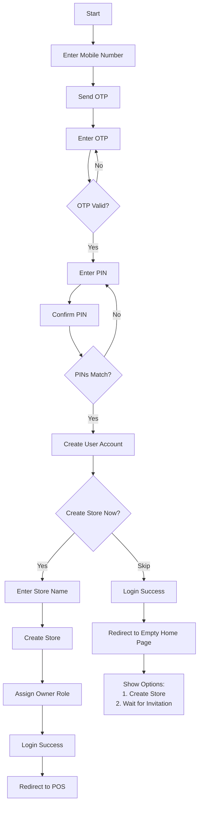
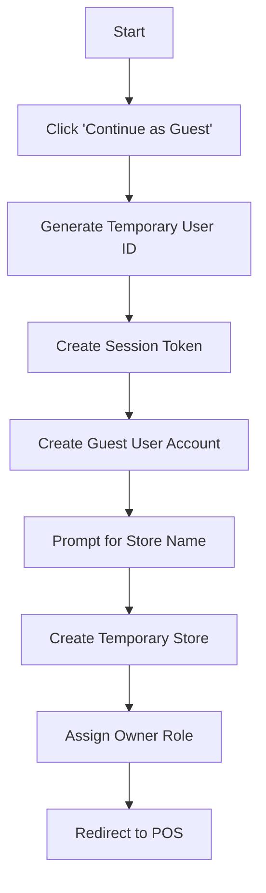
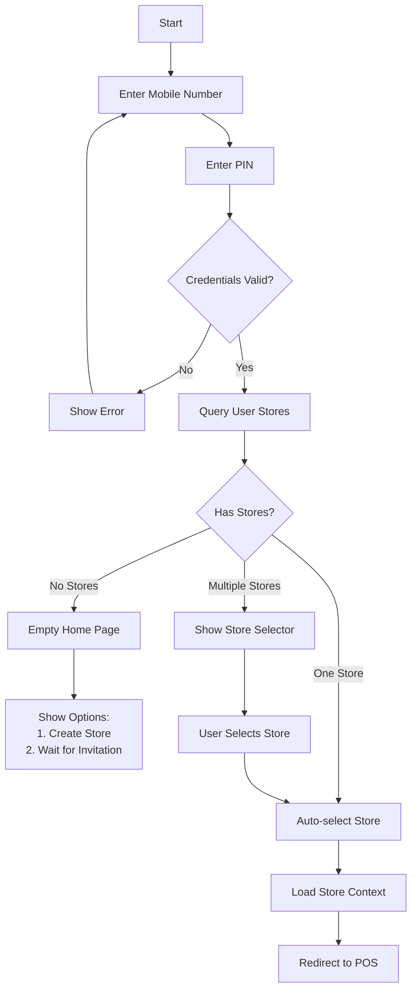
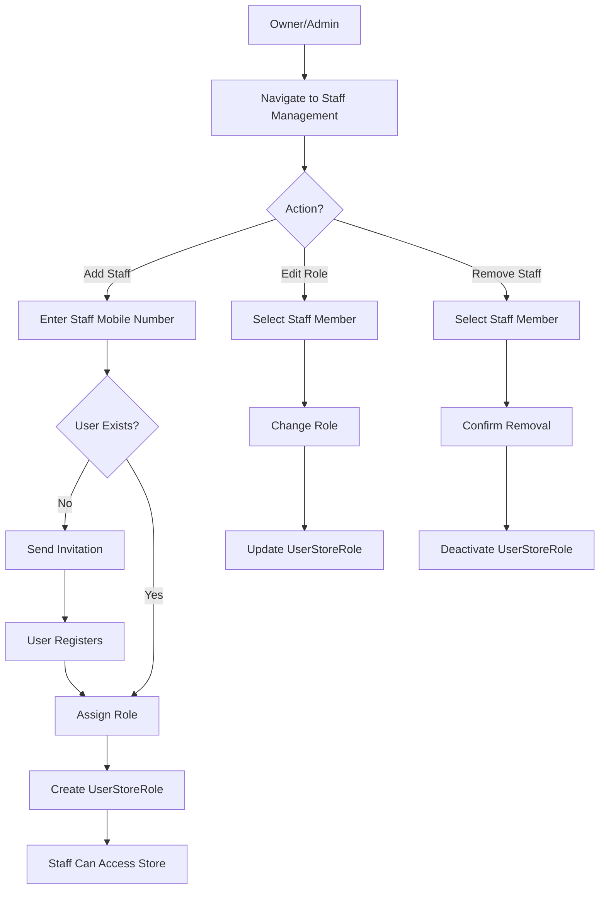
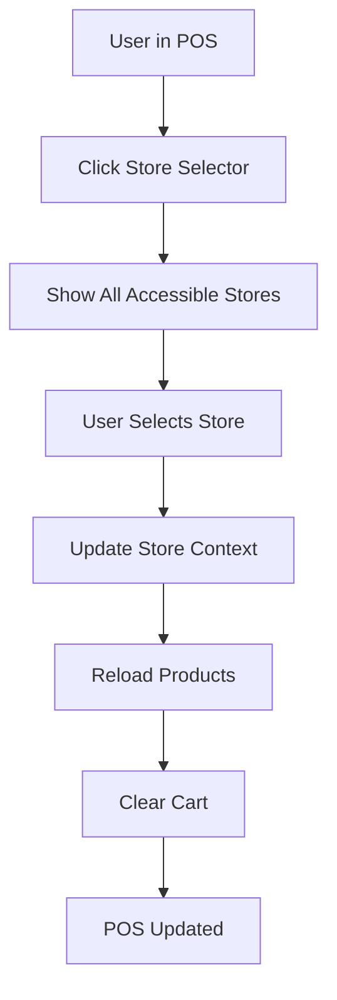

# Multi-Store POS System - Technical Specification

## Project Overview

A cloud-based Point of Sale (POS) system with multi-store management capabilities, built with React (frontend) and Go (backend), deployed on Netlify.

**Version:** 2.0  
**Last Updated:** November 10, 2025

---

## System Architecture

### Technology Stack

**Frontend:**
- React 18+ with Vite
- TailwindCSS for styling
- React Router for navigation
- Context API for state management

**Backend:**
- Go (Golang) 1.21+
- GORM (PostgreSQL ORM)
- JWT for authentication
- Supabase PostgreSQL database

**Deployment:**
- Netlify (Frontend & Serverless Functions)
- Supabase (Database)

---

## Core Concepts

### 1. Multi-Store System

**Store:**
- Entity representing a business/shop
- Can have multiple users (staff members)
- Contains its own product inventory
- Has its own sales/transaction history

**User-Store Relationship:**
- Many-to-Many relationship
- A user can belong to multiple stores with different roles
- A store can have multiple users with different permissions

### 2. User Types

#### A. Registered User (Mobile-based)
- Registers with: **Mobile Number + PIN only** (Store creation is optional)
- Mobile number serves as username
- Can optionally create a store during or after registration
- Can create/own multiple stores
- Can be invited to other stores as staff
- **Without a store or invitation**: Sees empty home page with option to create store or wait for invitation

#### B. Guest User (No registration)
- Logs in without providing credentials
- Creates temporary session
- **Must create a store** to use the system
- Can create and manage ONE store only
- **Cannot** be assigned to other stores
- Session-based (data lost on logout)

### 3. Role-Based Access Control (RBAC)

#### Owner (Store Creator)
- Full administrative rights
- Can manage all staff
- Can assign/remove roles
- Can delete store
- Access: Sell, Add, Edit, Delete products, Manage staff

#### Admin (Assigned by Owner)
- Full administrative rights
- Can manage all staff (except Owner)
- Can modify store settings
- Access: Sell, Add, Edit, Delete products, Manage staff

#### Manager (Assigned by Owner/Admin)
- Operational management rights
- **Cannot** manage staff
- Can manage inventory and sales
- Access: Sell, Add, Edit, Delete products

#### Staff (Assigned by Owner/Admin/Manager)
- Basic POS access
- Limited product management
- **Cannot** delete or edit existing products
- Access: Sell, Add products only

---

## Data Models

### User Model
```javascript
{
  id: UUID,
  mobile_number: String (unique, for registered users),
  pin_hash: String (hashed PIN),
  user_type: Enum ['REGISTERED', 'GUEST'],
  has_store: Boolean (indicates if user owns or belongs to any store),
  created_at: Timestamp,
  updated_at: Timestamp,
  
  // Relationships
  owned_stores: Store[],
  store_memberships: UserStoreRole[]
}
```

### Store Model
```javascript
{
  id: UUID,
  name: String (required),
  owner_id: UUID (references User),
  created_at: Timestamp,
  updated_at: Timestamp,
  is_active: Boolean,
  
  // Relationships
  products: Product[],
  staff: UserStoreRole[],
  transactions: Transaction[]
}
```

### UserStoreRole Model (Join Table)
```javascript
{
  id: UUID,
  user_id: UUID (references User),
  store_id: UUID (references Store),
  role: Enum ['OWNER', 'ADMIN', 'MANAGER', 'STAFF'],
  assigned_by: UUID (references User),
  assigned_at: Timestamp,
  is_active: Boolean
}
```

### Product Model
```javascript
{
  id: UUID,
  store_id: UUID (references Store),
  name: String,
  price: Decimal,
  stock: Integer,
  category: String,
  created_at: Timestamp,
  updated_at: Timestamp,
  
  // Relationships
  image: ProductImage
}
```

### ProductImage Model
```javascript
{
  product_id: UUID (references Product),
  image_data: Text (base64 encoded),
  created_at: Timestamp,
  updated_at: Timestamp
}
```

### Transaction Model
```javascript
{
  id: UUID,
  store_id: UUID (references Store),
  user_id: UUID (who processed the sale),
  items: TransactionItem[],
  total_amount: Decimal,
  payment_method: String,
  created_at: Timestamp
}
```

---

## User Flows

### 1. Registration Flow (Registered User)



**Steps:**
1. User enters mobile number
2. System sends OTP via SMS
3. User verifies OTP
4. User creates PIN (6 digits) and confirms
5. System creates user account (REGISTERED type)
6. **Optional Store Creation:**
   - **If user creates store:**
     - User enters Store Name
     - System creates store
     - User assigned as OWNER
     - Redirected to POS with full access
   - **If user skips:**
     - User logged in without store
     - Redirected to empty home page
     - Can create store later or wait for invitation
7. User without store/membership sees empty state with options

### 2. Guest Login Flow



**Steps:**
1. User clicks "Continue as Guest"
2. System generates temporary user ID and session token
3. System creates guest user (GUEST type)
4. **User must enter Store Name** (required for guests)
5. System creates:
   - Temporary store
   - Session-based authentication
   - UserStoreRole with OWNER role
6. User redirected to POS
7. **Note:** Data cleared on logout/session end

### 3. Login Flow (Existing User)



**Multi-Store Handling:**
- **No stores:** Empty home page with options to create or wait for invitation
- **1 store:** Auto-select and load POS
- **2+ stores:** Show selector, then load selected store's POS

### 4. Staff Management Flow



### 5. Store Switching Flow



---

## Permission Matrix

| Feature | Owner | Admin | Manager | Staff |
|---------|-------|-------|---------|-------|
| **POS Operations** |
| View Products | ✅ | ✅ | ✅ | ✅ |
| Sell Products | ✅ | ✅ | ✅ | ✅ |
| Process Payments | ✅ | ✅ | ✅ | ✅ |
| **Product Management** |
| Add Products | ✅ | ✅ | ✅ | ✅ |
| Edit Products | ✅ | ✅ | ✅ | ❌ |
| Delete Products | ✅ | ✅ | ✅ | ❌ |
| View Product Details | ✅ | ✅ | ✅ | ✅ |
| **Staff Management** |
| Add Staff | ✅ | ✅ | ❌ | ❌ |
| Remove Staff | ✅ | ✅ | ❌ | ❌ |
| Assign Roles | ✅ | ✅ | ❌ | ❌ |
| View Staff List | ✅ | ✅ | ❌ | ❌ |
| **Store Management** |
| Edit Store Info | ✅ | ✅ | ❌ | ❌ |
| Delete Store | ✅ | ❌ | ❌ | ❌ |
| View Reports | ✅ | ✅ | ✅ | ❌ |
| **System Access** |
| Switch Stores | ✅ | ✅ | ✅ | ✅ |
| Create New Store | ✅ (Registered) | ✅ (Registered) | ✅ (Registered) | ✅ (Registered) |

**Guest User Restrictions:**
- ❌ Cannot be assigned to other stores
- ❌ Cannot invite/manage staff from other stores
- ✅ Can only manage their own created store

---

## Page Structure

### 1. Home Page - `/`
**Access:** All authenticated users

**Two States:**

#### A. Empty State (No Store Access)
**When:** User has no owned stores and no store memberships

**Components:**
- Welcome message
- Two primary actions:
  1. **Create Your Store** button
  2. **Waiting for Invitation** message
- Help text explaining next steps
- Profile menu (settings, logout)

**UI:**
```
┌─────────────────────────────────────┐
│  Welcome, [User]!                   │
│                                     │
│  You don't have access to any store │
│  yet. Choose an option below:       │
│                                     │
│  ┌──────────────────────────┐      │
│  │  Create Your First Store │      │
│  └──────────────────────────┘      │
│                                     │
│  Or wait to be invited to a store  │
│  by another user.                   │
└─────────────────────────────────────┘
```

#### B. POS Page (Has Store Access)
**When:** User has at least one store (owned or member)

**Components:**
- Product Grid (filtered by current store)
- Shopping Cart
- Category Filter
- Search Bar
- Store Selector Dropdown (if multiple stores)
- User Menu

**Role-Based UI:**
- Owner/Admin/Manager: Show "Manage Products", "Manage Staff" buttons
- Staff: Hide management buttons

### 2. Products Management - `/products`
**Access:** Owner, Admin, Manager

**Features:**
- Product List (current store)
- Add Product Form
- Edit Product (inline or modal)
- Delete Product (with confirmation)
- Bulk Operations

### 3. Staff Management - `/staff`
**Access:** Owner, Admin

**Features:**
- Staff List (current store)
- Add Staff Form (mobile number lookup)
- Role Assignment
- Remove Staff
- Activity Log

### 4. Store Settings - `/store/settings`
**Access:** Owner, Admin

**Features:**
- Store Name
- Store Information
- Branding/Logo
- Delete Store (Owner only)

### 5. My Stores - `/stores`
**Access:** All registered users

**Features:**
- List of all stores user belongs to
- Create New Store
- Quick switch between stores
- View role in each store

### 6. Authentication Pages
- `/login` - Login/Register
- `/login/guest` - Guest login

---

## API Endpoints

### Authentication
```
POST   /api/auth/send-otp          - Send OTP to mobile
POST   /api/auth/verify-otp        - Verify OTP
POST   /api/auth/register          - Register new user (no store required)
POST   /api/auth/login             - Login with mobile + PIN
POST   /api/auth/guest             - Create guest session + store
POST   /api/auth/logout            - Logout current user
GET    /api/auth/me                - Get current user info + store count
```

### Stores
```
GET    /api/stores                 - List user's stores
POST   /api/stores                 - Create new store
GET    /api/stores/:id             - Get store details
PUT    /api/stores/:id             - Update store
DELETE /api/stores/:id             - Delete store (owner only)
GET    /api/stores/:id/staff       - List store staff
POST   /api/stores/:id/staff       - Add staff member
PUT    /api/stores/:id/staff/:uid  - Update staff role
DELETE /api/stores/:id/staff/:uid  - Remove staff member
```

### Products
```
GET    /api/stores/:id/products              - List products (by store)
POST   /api/stores/:id/products              - Create product
GET    /api/stores/:id/products/:pid         - Get product details
PUT    /api/stores/:id/products/:pid         - Update product
DELETE /api/stores/:id/products/:pid         - Delete product
GET    /api/stores/:id/products/:pid/image   - Get product image
```

### Transactions
```
GET    /api/stores/:id/transactions          - List transactions
POST   /api/stores/:id/transactions          - Create transaction (sale)
GET    /api/stores/:id/transactions/:tid     - Get transaction details
POST   /api/stores/:id/products/stock/batch  - Batch stock update
```

---

## Security Considerations

### 1. Authentication
- JWT tokens with expiration
- Refresh token mechanism
- PIN hashing (bcrypt)
- OTP verification for registration
- Guest sessions expire on browser close

### 2. Authorization
- Role-based middleware on all protected routes
- Store membership verification
- Action permissions checked server-side
- Guest users restricted from multi-store features

### 3. Data Isolation
- All queries scoped to current store
- Users can only access stores they belong to
- Cross-store data leakage prevention
- Soft delete for audit trails

### 4. API Security
- Rate limiting on auth endpoints
- CORS configuration
- Input validation and sanitization
- SQL injection prevention (parameterized queries)
- XSS protection

---

## State Management

### Frontend Context Structure

```javascript
// AuthContext
{
  user: User | null,
  currentStore: Store | null,
  userStores: Store[],
  isAuthenticated: boolean,
  isGuest: boolean,
  login: (mobile, pin) => Promise,
  loginAsGuest: () => Promise,
  logout: () => void,
  switchStore: (storeId) => Promise,
  refreshUser: () => Promise
}

// StoreContext (per store)
{
  store: Store,
  products: Product[],
  staff: UserStoreRole[],
  userRole: 'OWNER' | 'ADMIN' | 'MANAGER' | 'STAFF',
  permissions: {
    canManageProducts: boolean,
    canDeleteProducts: boolean,
    canManageStaff: boolean,
    canEditStore: boolean,
    canDeleteStore: boolean
  },
  addProduct: (product) => Promise,
  updateProduct: (id, product) => Promise,
  deleteProduct: (id) => Promise,
  addStaff: (mobile, role) => Promise,
  removeStaff: (userId) => Promise,
  updateStaffRole: (userId, role) => Promise
}

// CartContext (per store)
{
  cart: CartItem[],
  addToCart: (product) => void,
  removeFromCart: (productId) => void,
  updateQuantity: (productId, qty) => void,
  clearCart: () => void,
  getTotalPrice: () => number,
  checkout: () => Promise
}
```

---

## UI/UX Guidelines

### Design Principles
1. **Google Material Design** - Clean, minimal, elegant
2. **Mobile-First** - Optimize for touch screens
3. **Consistent** - Uniform spacing, colors, components
4. **Feedback** - Loading states, success/error toasts
5. **Accessible** - Keyboard navigation, screen readers

### Store Selector
- Dropdown in header (mobile & desktop)
- Shows store name + user role
- Quick switch without navigation
- Badge showing number of accessible stores

### Role Indicators
- Subtle badges showing user role in current store
- Color-coded: Owner (gold), Admin (blue), Manager (green), Staff (gray)
- Guest indicator (temporary/session)

### Permission-Based UI
- Hide unavailable actions (don't just disable)
- Clear messaging when action not permitted
- Graceful degradation for staff users

---

## Migration Plan (From Single-Store to Multi-Store)

### Phase 1: Database Schema Updates
1. Add `Store` table
2. Add `UserStoreRole` join table
3. Add `store_id` to `Product` table
4. Add `store_id` to `Transaction` table
5. Add `user_type` to `User` table

### Phase 2: Data Migration
1. Create default store for each existing user
2. Assign all existing users as store owners
3. Associate all existing products with respective stores
4. Migrate transaction history

### Phase 3: Backend Updates
1. Update authentication to include store context
2. Add store-scoped queries
3. Implement RBAC middleware
4. Add guest user functionality

### Phase 4: Frontend Updates
1. Add store selector component
2. Update contexts for multi-store support
3. Add staff management UI
4. Add store management UI
5. Update all product operations to include store context

### Phase 5: Testing & Deployment
1. Unit tests for RBAC
2. Integration tests for multi-store flows
3. E2E tests for critical paths
4. Gradual rollout with feature flags

---

## Future Enhancements

### Phase 3 Features
- [ ] Inventory alerts (low stock notifications)
- [ ] Sales analytics dashboard
- [ ] Multi-payment methods (cash, card, digital wallets)
- [ ] Receipt generation (PDF/print)
- [ ] Customer management
- [ ] Loyalty program

### Phase 4 Features
- [ ] Multi-location support (same store, different locations)
- [ ] Supplier management
- [ ] Purchase orders
- [ ] Expense tracking
- [ ] Profit/loss reports
- [ ] Tax calculations

### Phase 5 Features
- [ ] Mobile app (React Native)
- [ ] Offline mode (PWA)
- [ ] Barcode scanning
- [ ] Integration with payment gateways
- [ ] API for third-party integrations
- [ ] Franchise management

---

## Development Workflow

### Branch Strategy
- `main` - Production
- `develop` - Development
- `feature/*` - New features
- `bugfix/*` - Bug fixes
- `hotfix/*` - Production hotfixes

### Testing Requirements
- Unit tests for business logic
- Integration tests for API endpoints
- E2E tests for critical user flows
- Minimum 80% code coverage

### Deployment Process
1. Merge to `develop` → Auto-deploy to staging
2. QA testing on staging
3. Merge to `main` → Auto-deploy to production
4. Monitor error logs and metrics

---

## Glossary

**Store** - A business entity with its own inventory and staff  
**Owner** - User who created the store, has full control  
**Admin** - User with full administrative rights (assigned by owner)  
**Manager** - User who can manage operations but not staff  
**Staff** - User with basic POS access  
**Guest User** - Temporary user without registration  
**Registered User** - User with mobile number authentication  
**UserStoreRole** - Relationship defining user's role in a specific store  
**OTP** - One-Time Password for mobile verification  
**RBAC** - Role-Based Access Control  

---

## Contact & Support

**Repository:** github.com/jjericjjeric/pos-ui  
**Documentation:** /docs  
**Issues:** github.com/jjericjjeric/pos-ui/issues  

Last Updated: November 10, 2025
